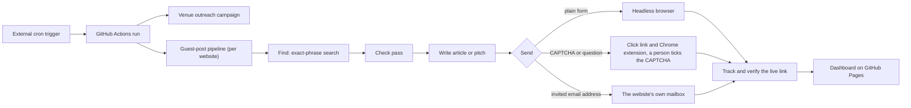

# Backlink Builder

An automated, safety-first system that finds websites which accept articles from outside authors, checks each one against strict rules, writes an original article and submits it. It runs unattended on GitHub Actions for three real websites. The system has run daily since July 2026, and the guest-post pipeline described here replaced its first design in November 2026.

**Stack:** Python 3.12, Gemini API, Tavily and Firecrawl, Playwright, a Chrome extension (Manifest V3), a static dashboard on GitHub Pages, GitHub Actions. About 5,900 lines of Python and 4,500 lines of tests (458 automated tests).

> **How this was built.** I designed the system, set its safety rules and operate it daily. The code was written with an AI coding assistant (Claude Code) under my direction, and I own the architecture, the constraints, the review and the tests. The [engineering log](docs/ENGINEERING_LOG.md) records real incidents, how each was found and what fixed it.

## What it does

1. **Find.** Daily, rate-limited searches for exact "write for us" style phrases in each website's niche (Tavily).
2. **Check.** Each candidate page goes through deterministic checks first, then a language-model judgement whose answers must be backed by verified quotes.
3. **Write.** An original article (or a short pitch, when the website asks for one) follows that website's own guidelines, with quality gates.
4. **Send.** One of three routes: a headless browser fills and sends a plain form; a prepared link lets a person tick a CAPTCHA while a Chrome extension fills the rest; or an email goes to an address the website's guidelines invite, from the organisation's own mailbox.
5. **Track.** A submission only counts once the live page is found and the backlink is verified. Sending is never treated as success.

## What makes it interesting engineering

- **Evidence or rejection.** The model must answer in JSON and back every "yes" with an exact quote from the page. Plain code then checks that the quote really is there, so an answer without verified evidence is rejected. This stops invented answers.
- **Code first, model second.** Cheap deterministic checks (domain exclusions, robots.txt, form structure, address context, wording rules) remove most pages before any model call. That cuts cost and keeps decisions explainable.
- **Fails soft.** When the model service is busy, the client switches models and keys, waits inside a per-run time budget, and the run carries on with the code-only checks instead of stopping. Waiting pages are picked up at the next run.
- **A strict lifecycle.** Jobs move through an explicit state machine with allowed transitions only, and each change is recorded with its reason. Nothing is sent twice, even if a run is interrupted.
- **Independent verification.** A separate component ignores what a submission reported and looks at the live page for the link.
- **One filler for two senders.** The Chrome extension and the automatic browser sender share the same form-filling code, so both behave the same way, and both are tested against a real headless browser.
- **Measured, not guessed.** When too few websites passed, I counted where they were being lost and fixed the causes one by one. See the [engineering log](docs/ENGINEERING_LOG.md).

## Architecture



More detail, including the check pipeline and the state machine, is in [docs/ARCHITECTURE.md](docs/ARCHITECTURE.md).

## Safety and ethics, enforced in code

| Rule | How it is enforced |
|---|---|
| Never bypass a CAPTCHA or bot check | The automatic sender stops at any CAPTCHA or human question. The extension waits until a person has answered it. |
| Respect robots.txt and "no automation" notices | Checked before a page is used. |
| No fake accounts | Websites that need an account, a login or a membership are refused. |
| Be honest about AI | The articles are written with AI, so a website that forbids or limits AI-written text, or asks link builders not to apply, is refused. |
| Never contact competitors | Excluded by word lists and by a second model check. |
| Low, controlled volume | A hard daily cap per website, daily search and credit limits, one use per website ever, and one email per address ever. |
| Email only where invited | The address must come from the website's own guidelines, never a footer contact, and is used from the organisation's own mailbox. |
| Lawful marketing email | The separate venue campaign only writes to registered companies, with an opt-out line. |

## Testing

458 tests run with `pytest` and Node:

- The language model is replaced by a scripted fake judge, and the web by a fake web, so every branch can be tested without a network.
- A test starts the daily run exactly as GitHub starts it, because an early version passed all its tests but failed on the first real run.
- Real headless Chromium tests fill and send a local form (and are skipped when no browser is installed). The extension and dashboard run in jsdom.
- Every incident in the engineering log has a named regression test. I ran each one against the code from just before its fix: eight fail because the behaviour is wrong, and one fails only because it calls a function that did not exist yet.

## Results and honest limitations

- In its first full week on the strict rules, the system opened about 410 pages. Only 169 were genuine "write for us" pages, and **3 passed every check**. The causes were measured (search results that were ordinary articles, rules that were too strict about email addresses and login boxes, wasted re-checks) and fixed. The engineering log has the numbers.
- Free-tier language models are unreliable at peak times, so a run may leave some pages for the next day.
- Many websites have no usable form, ask for an account, or forbid AI-written text, so volume is deliberately modest and some days produce nothing.
- A sent article is not a published one. Editors decide, often after weeks, and only a verified live link counts.
- The heuristics are tuned for English-language websites.

## Repository layout

| Path | What is there |
|---|---|
| `src/backlinks/` | The guest-post pipeline: discovery, checks, writing, sending, tracking, verification, state machine |
| `src/` | Entry points, discovery clients, the venue campaign, the site profiler |
| `extension/` | The Chrome extension (Manifest V3) and the shared form filler |
| `dashboard/` | The single-page dashboard and its DOM test |
| `config/` | Per-site and per-run configuration (example values) |
| `tests/` | The Python test suite |
| `docs/` | Architecture, engineering log and the example workflows |

## Running it yourself

```bash
pip install -r requirements.txt
python -m pytest -q
cd dashboard && npm install && cd ..    # only for the dashboard and extension tests
node dashboard/dom_test.js
node extension/test_extension.js
```

Secrets are never committed. The pipeline reads them from the environment (in production, GitHub Actions secrets): `GEMINI_API_KEY`, `TAVILY_API_KEY`, `FIRECRAWL_API_KEY`, `GOOGLE_PLACES_API_KEY` and one SMTP password per mailbox. The scheduled workflows are kept under `docs/example-workflows/` because they need those secrets and a private repository that stores the run state.

## Licence

MIT. See [LICENSE](LICENSE).
