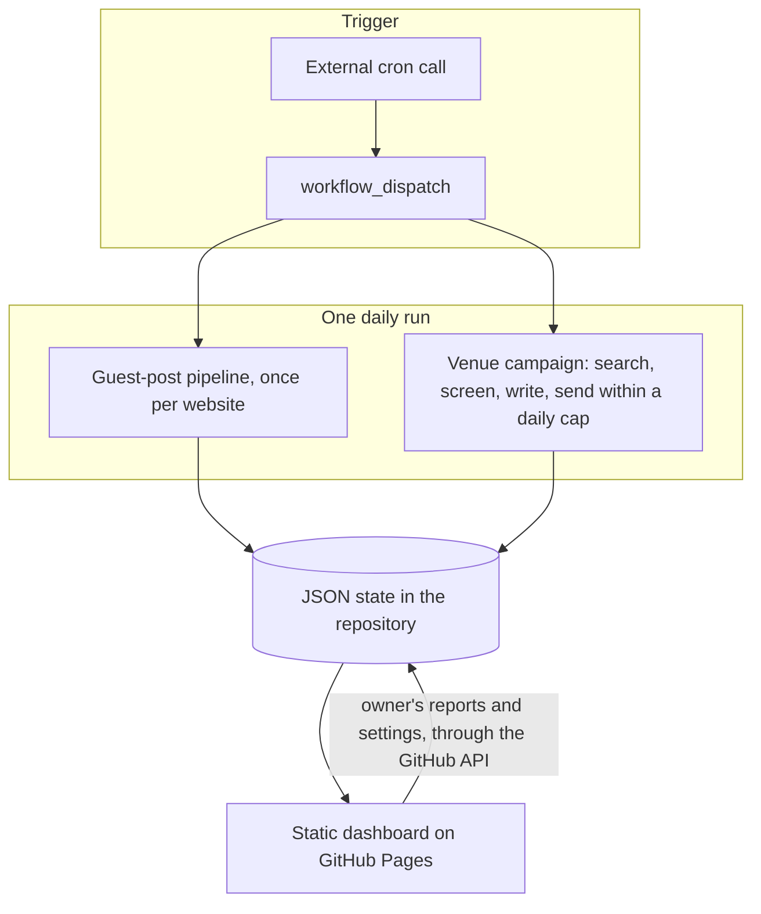
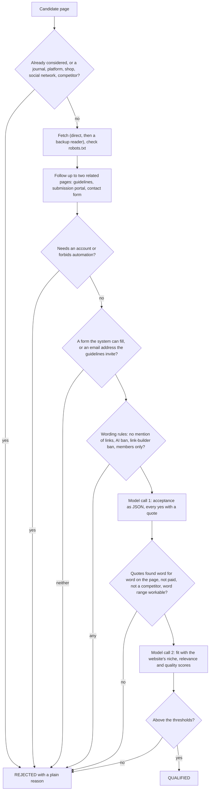
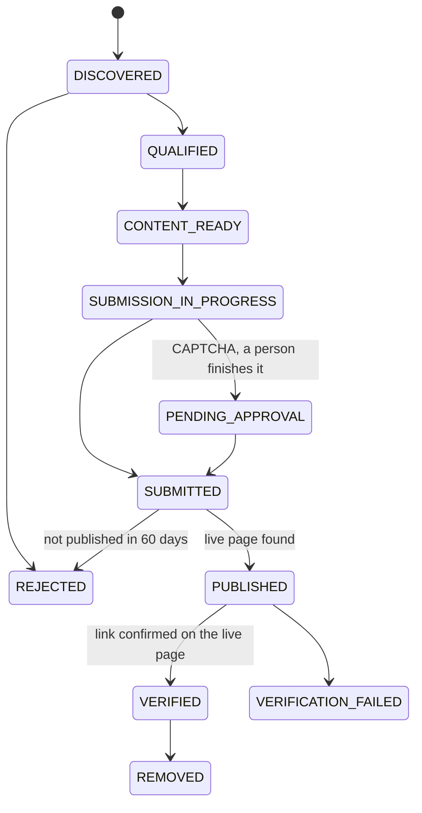

# Architecture

## Overview

One scheduled run per day does two jobs for each configured website: it advances the guest-post pipeline, and it runs a small, separate email campaign. State lives in JSON files committed back to the repository by the workflow, so there is no server and no database to operate. A static dashboard reads and writes that state through the GitHub API.

The trigger is an external cron call to `workflow_dispatch`, because GitHub's own `schedule` trigger fired hours late and sometimes twice, which doubled the use of paid search credits. A concurrency group queues overlapping runs, and pushes retry with a rebase.

## The guest-post pipeline

Per website and per run: watchdog, discover, check, write, send, track.

### The check pass

Every candidate page goes through the same ordered gates. The cheap deterministic gates come first, so most pages never reach the model.

If the model service is unavailable, the pass keeps going with the deterministic gates and leaves the pages that need the model for the next run.

### Lifecycle

Every job follows an explicit state machine (`src/backlinks/states.py`). A transition outside the allowed table raises an error, and every transition stores its reason and time.

Only `VERIFIED` counts as a backlink. An accepted submission, a generated article or a sent email is never success.

## The language-model client

`src/backlinks/llm.py` wraps the model client with the behaviour a daily unattended job needs:

- **Failover.** Several models are tried in order, and extra API keys are used when one key is refused or out of quota. Quota errors that Google marks as per-day take that key out for the rest of the run, while temporary errors do not.
- **Error classification.** Quota, authorisation, busy, network and truncated replies are told apart, because each needs a different response.
- **A time budget.** Time lost to failed or hanging requests, to the slow part of replies and to waiting between attempts is counted per website per run, and each request gets a deadline inside what is left. After the budget is spent, the website's remaining model work waits for the next run.
- **A call cap** counted by the system itself, as a second guard beside the provider's limits.
- **A stub for outages.** After the first failure, a stand-in client raises "busy" immediately, so the rest of the pass spends no more requests or time on the model.

## Sending

- **Browser route (`browser.py`).** Playwright fills the mapped fields with the same script the extension uses, waits until the values have stayed put, presses Send and reads the result. If a CAPTCHA, an invisible CAPTCHA or a human-check question is on the live form, it stops and hands the job to a person.
- **Extension route.** The job becomes a link with the form values in the URL fragment, which is never sent to the website. The Manifest V3 extension acts only on pages that carry that marker, fills the form, highlights the CAPTCHA and waits until the person has answered it. It never touches the CAPTCHA.
- **Email route.** An address is used only when the website's own guidelines invite submissions there. The email goes out from the organisation's own mailbox, with a Word file attached when the website asks for one.

## Forms

`map_form` assigns a role to every field (name, email, title, article, bio, consent and so on) and refuses the form when a required field cannot be filled with confidence. It ignores comment boxes and site-wide footer or sidebar forms, treats hidden and honeypot fields as traps that are never touched, never ticks newsletter boxes, and leaves human-check questions for a person.

## Storage and configuration

State is one JSON file per concern, written by `store.py` and committed by the workflow, which also keeps the history of every run. Configuration is YAML per website (niche words, author, bio, quotas, limits). Per-website switches that the owner changes from the dashboard live in a small JSON settings file.

## The dashboard and the extension

The dashboard is a single static page. It reads `state/dashboard.json` through the GitHub API with a fine-grained token kept only in the owner's browser, and writes the owner's reports back to the repository, merging and retrying on conflicts. The extension and the automatic sender share `extension/fill.js`.

## What I would improve next

- Build a labelled evaluation set for the fit judgement and measure precision and recall, instead of relying on thresholds.
- Replace the committed JSON state with a small database when volume grows.
- Use a second, cheaper model as an independent check on the acceptance answers.
- Show the verified quotes next to each decision on the dashboard.
